Visual Integrated Development Environment for Artificial Neural Networks Based on Blueprint System
=

[English](README.en.md)

# Project Status

[](https://gitee.com/zzc1024/Visual-ANN/stargazers)
[](https://gitee.com/zzc1024/Visual-ANN/members)

[](https://gitee.com/zzc1024/Visual-ANN)

This is a graduation project.

Currently under development and not yet completed.

# Software Introduction

## Overall Preview

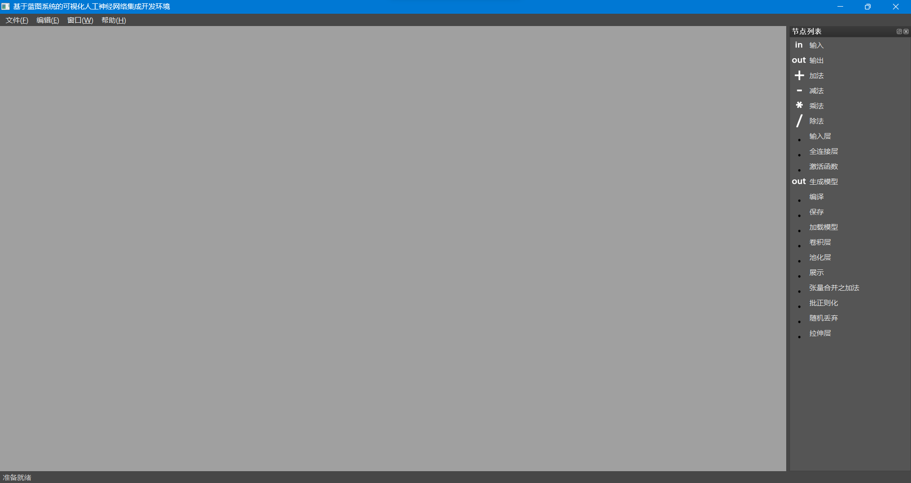

Click on the menu bar to display the following window:

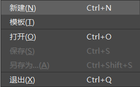

Click "New" to create your first node editor window:

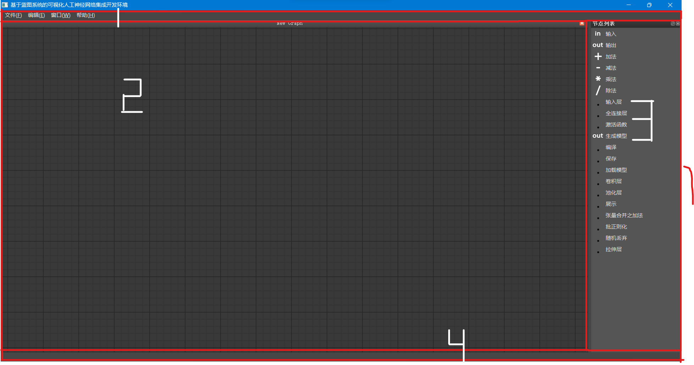

The above image shows four main areas:

1. **Menu Bar**: This section includes multiple menus. Most operations have keyboard shortcuts, and common file operations are located under the "File" menu.

2. **Node Editor**: This area can have multiple editing scenes that do not conflict with each other, but the same file cannot be opened multiple times. Left-click to interact with nodes, middle-click to move and zoom the view, and right-click to open the menu. Nodes in this area can be obtained by dragging and dropping from the "Node List" (section 3).

3. **Node List**: This section provides various built-in nodes for users to choose from. Currently, only convolutional neural networks that perform checkpoint operations can be created. If this window disappears, it can be reopened from the "Window" menu in section 1 by selecting "Node List."

4. **Status Bar**: This area informs the user about the current status or specific operations.

## Theoretical Background

Using the toy ResNet example from the official Keras documentation, we will implement a simple ResNet model as shown below:

[](https://keras.io/guides/functional_api/#a-toy-resnet-model)

Here is the implementation code:

```python3
import keras
from keras import layers


inputs = keras.Input(shape=(32, 32, 3), name="img")
x = layers.Conv2D(32, 3, activation="relu")(inputs)
x = layers.Conv2D(64, 3, activation="relu")(x)
block_1_output = layers.MaxPooling2D(3)(x)

x = layers.Conv2D(64, 3, activation="relu", padding="same")(block_1_output)
x = layers.Conv2D(64, 3, activation="relu", padding="same")(x)
block_2_output = layers.add([x, block_1_output])

x = layers.Conv2D(64, 3, activation="relu", padding="same")(block_2_output)
x = layers.Conv2D(64, 3, activation="relu", padding="same")(x)
block_3_output = layers.add([x, block_2_output])

x = layers.Conv2D(64, 3, activation="relu")(block_3_output)
x = layers.GlobalAveragePooling2D()(x)
x = layers.Dense(256, activation="relu")(x)
x = layers.Dropout(0.5)(x)
outputs = layers.Dense(10)(x)

model = keras.Model(inputs, outputs, name="toy_resnet")
model.summary()
```

ResNet is a residual neural network, whose core is a residual network structure, as illustrated below:

[](https://zhuanlan.zhihu.com/p/349717627)

## Building the Model

**Note:** Some images in the following steps contain errors and are for reference only. If you want to follow the design, please refer to the final screenshot below.

First, we need to design the basic residual network structure.

We can obtain a simple 2D convolution node by dragging and dropping as shown in the diagram.
Although the node does not display the purpose of each parameter, you can get hints by hovering over it with the mouse.

The three integer input fields from top to bottom represent filters, kernel size, and strides.
The dropdown box at the bottom represents the padding method.

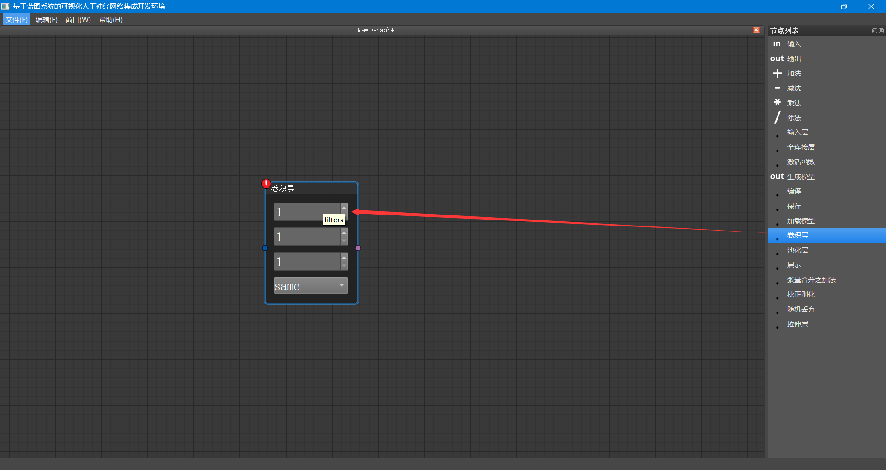

In this example, only the first two parameters are provided; the others can be considered as default Keras API values.
You can [check the official Keras documentation](https://keras.io/api/layers/convolution_layers/convolution2d/) for details.

After checking, the first three parameters are 32, 3, and 1, respectively, and padding is "valid."

The official code also includes an activation option, which is not present in this node. However, you can select an activation function from the node list and add it:

After adding, it looks like this:

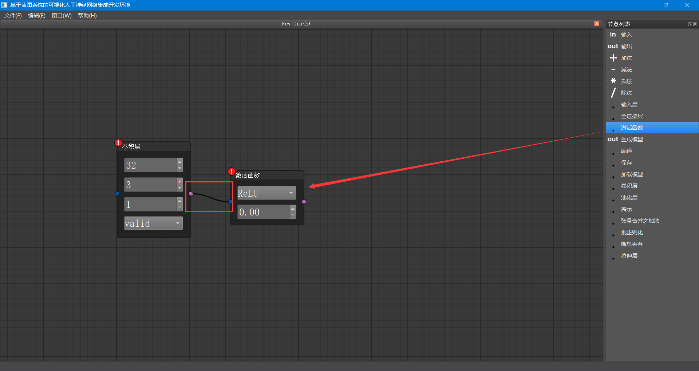

Don't forget to connect the two nodes before and after.

The parameter below the activation function node is set to 0 and cannot be changed arbitrarily, as this would transform it into a Leaky ReLU function.

Select these elements with the left mouse button and press "Ctrl + C" to copy the basic convolution node combination.

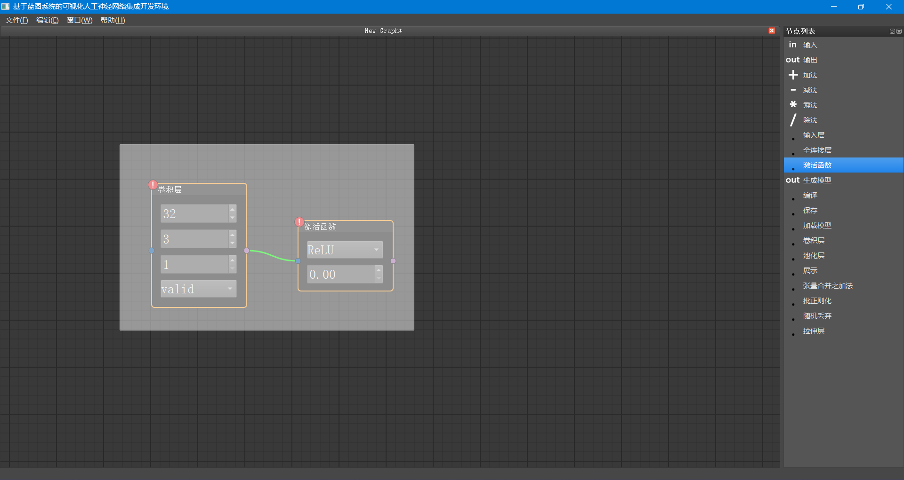

Then press "Ctrl + V" to paste the copied content and connect the two node groups together.

This creates a basic small node group representing the residual structure.

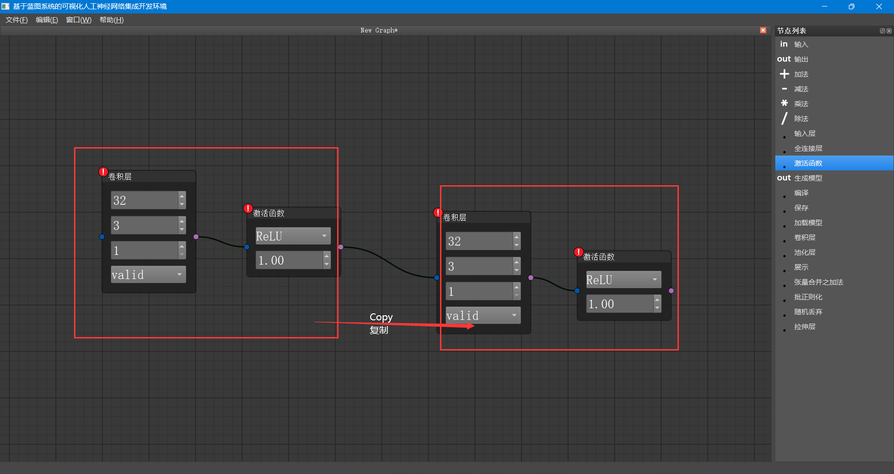

Copy this small node group three times, and add a pooling node (MaxPool2D) after the first node group. Set poolSize to 3, padding to "same," and strides to 1.
Add an "Add" layer (to be changed to a "Merge" node later) after the other two node groups.
Connect each node group with the newly added nodes. The final result is as follows:

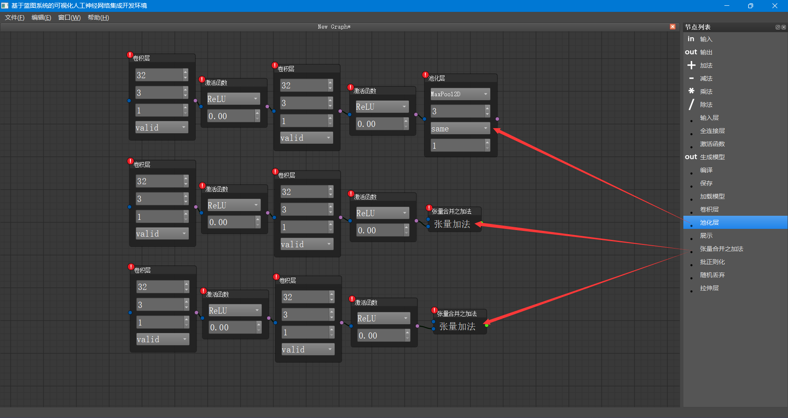

Each level is connected from start to end, and the "Add" node is connected to the previous activation function and the last node of the previous level.
This is a crucial aspect of residual neural networks. The result is as follows:

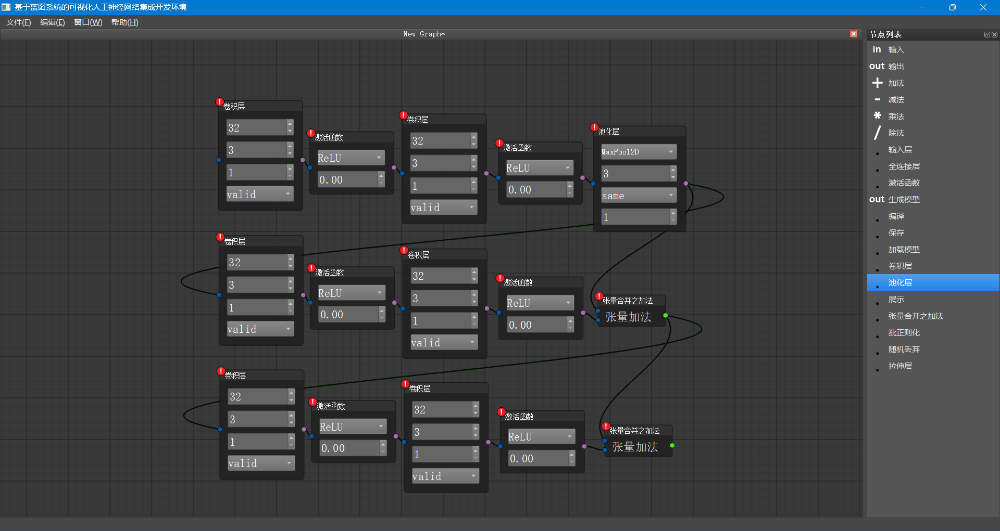

Then, add the remaining parts of ResNet after the last node and modify the incorrect parameters in front.
(I was too lazy to take another screenshot; see the final screenshot for details)

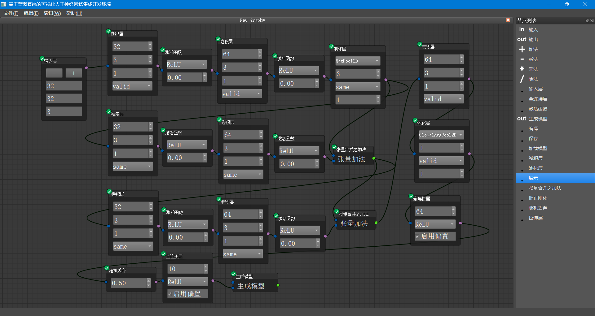

The nodes in the upper left corner of the above diagram have turned green. This is because there was no input layer before, so all nodes were incomplete and became dirty nodes. After adding the input layer, the content of these nodes was completed, so they became green correct indicators.

## Save Project

In the menu bar, select "File" -> "Save" or press "Ctrl + S" to save the current project. As shown in the diagram:

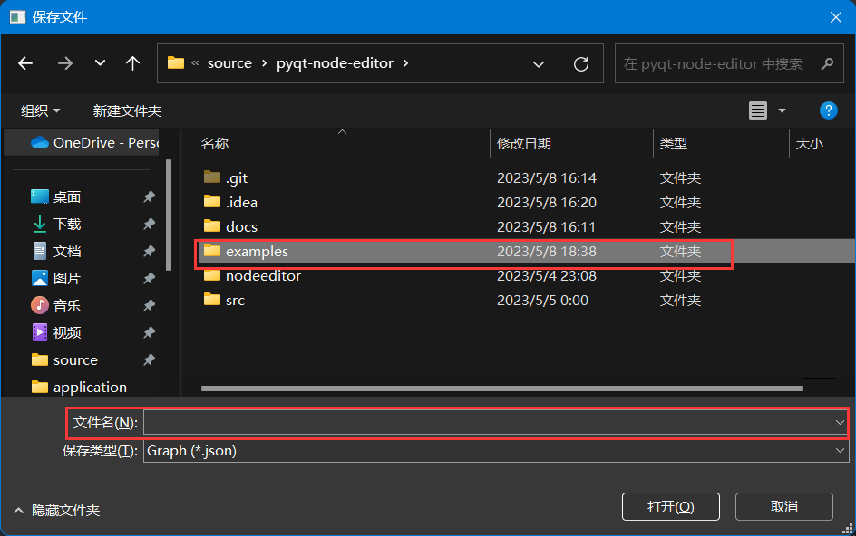

Select the save location and enter the file name to save.

**Note:** When reopening the software, nodes may all be in an invalid state,
which may be due to an unknown bug or because the framework used by this software employs lazy computation.
When reloading, if you encounter the situation shown in the diagram, you can right-click on an invalid node and click to compute that node.

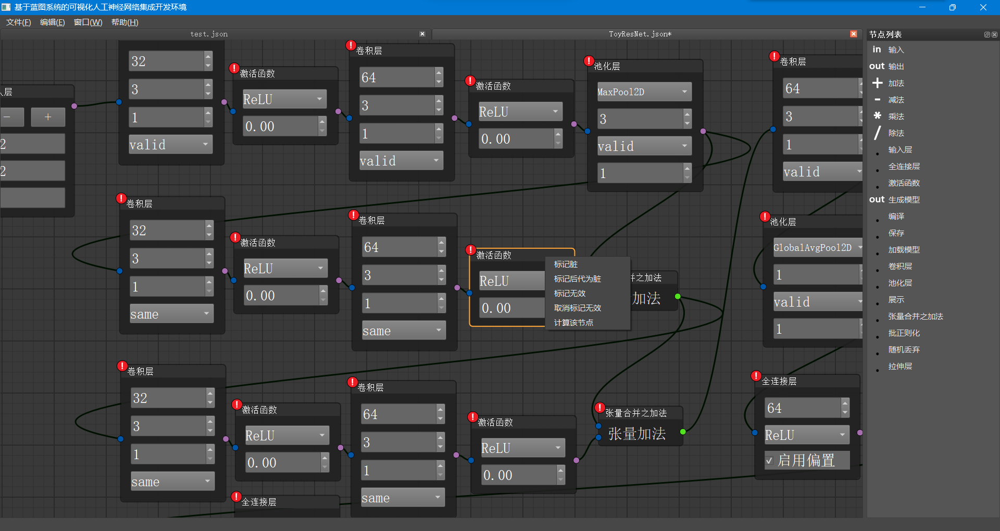

## Model Operations

There are three ways to operate on the model: compile, save, and view.

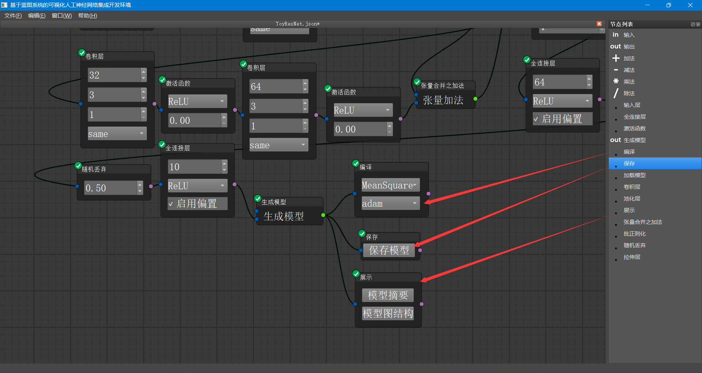

### Compile

Compilation has two parameters: cost function and optimizer.

### Save

The save node has only one button. Pressing the button will bring up an option to select the save path:

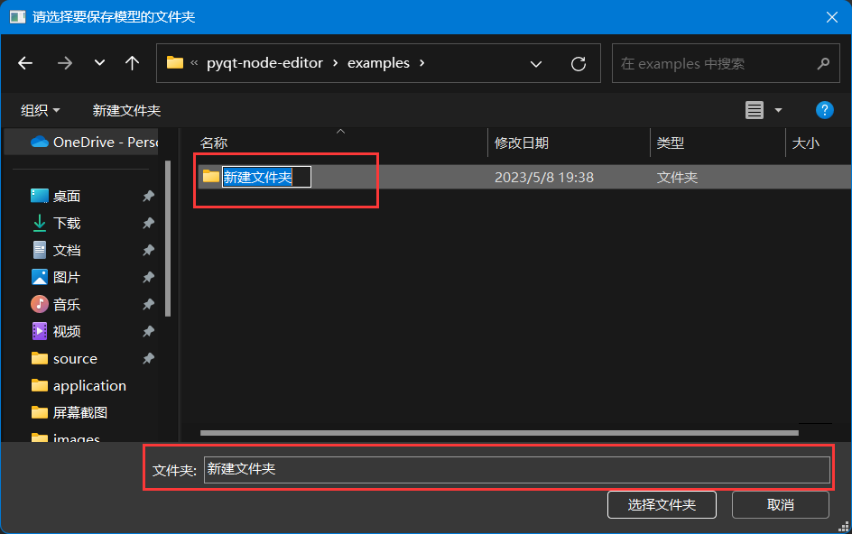

Create a new folder and name it. This folder will save the model information.

**Note:** Do not end the folder name with ".keras" or ".h5," as this will automatically generate a single-file model,
and this type of file cannot be recognized by this software.

### View

This feature is implemented by the display node:

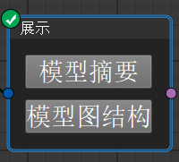

Click "Model Summary" to obtain a plain text model summary file.

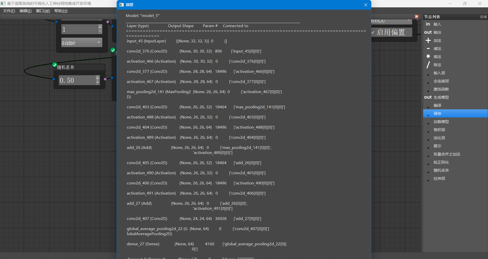

Click "Model Structure Graph" to obtain the graph structure of the model.

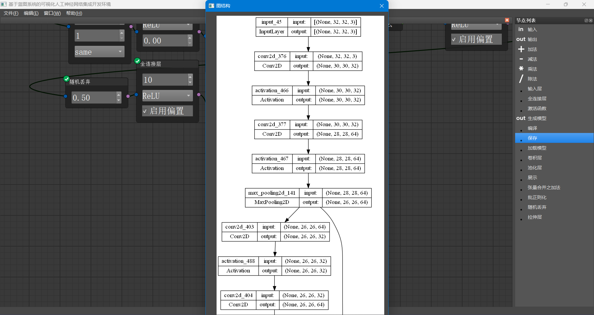

The image will be temporarily stored in the `src/application/tmp.png` directory.

## Load Template

Click "File" -> "Template" in sequence, and a dialog box will pop up:

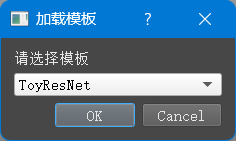

Select the desired template to load, then click "OK" to load the following template:

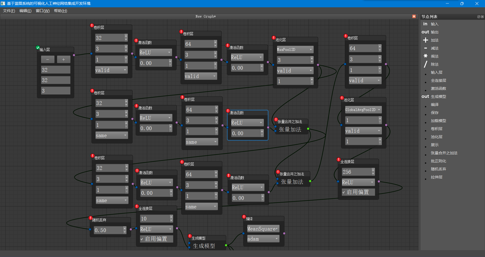

The loaded template needs to be saved by the user separately.

Since computing nodes will take a lot of time, the user needs to manually compute nodes here.
This is actually a bug.
